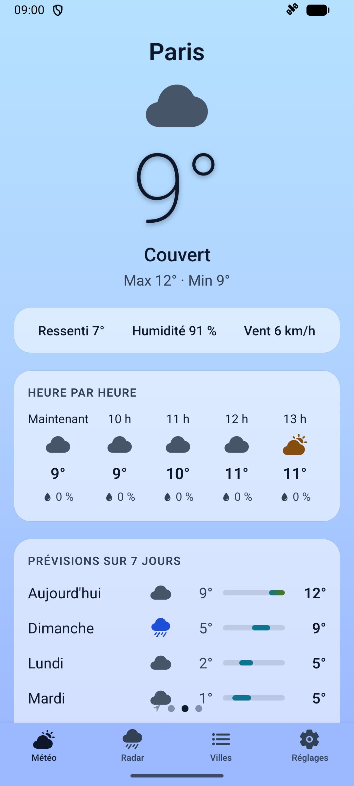
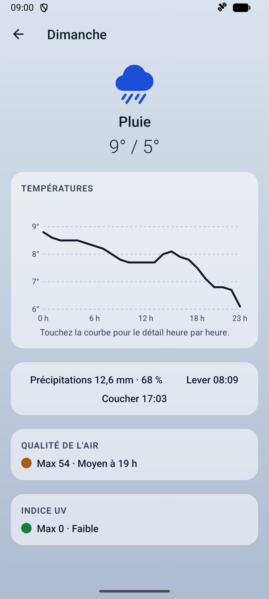
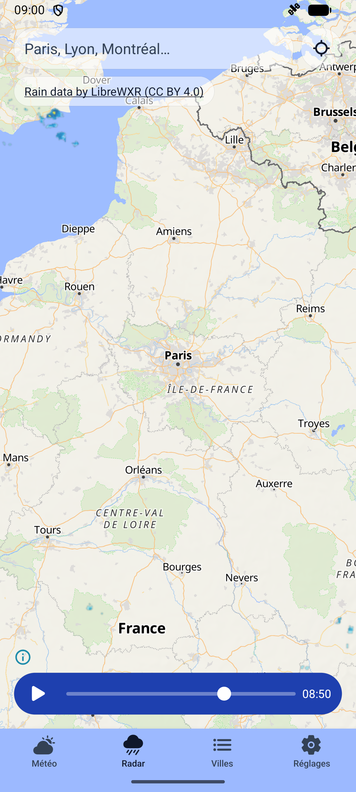
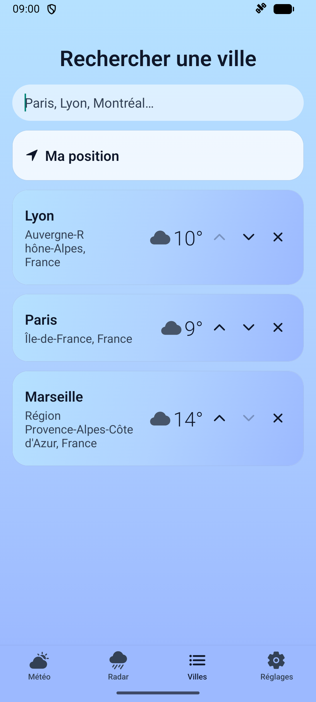

# Wétéo

Application météo personnelle pour Android, sans compte, sans serveur, sans publicité et sans pistage.
Construite avec Expo (SDK 57) et React Native, elle interroge directement [Open-Meteo](https://open-meteo.com).

<p align="center">
  
  
  
  
</p>

## Fonctionnalités

- Météo actuelle de votre position ou de n'importe quelle ville
- Prévisions heure par heure et sur 7 jours, détail de chaque jour (températures, pluie, lever et coucher du soleil)
- Indice UV et qualité de l'air
- Carte radar de la pluie avec prévision à une heure ([LibreWXR](https://github.com/JoshuaKimsey/LibreWXR), fond [OpenFreeMap](https://openfreemap.org))
- Recherche de villes et liste de favoris
- Alertes pluie en arrière-plan
- Widget pour l'écran d'accueil Android
- Fonctionne hors ligne avec la dernière météo connue
- Unités au choix (température, vent, précipitations), thème clair, sombre ou automatique
- En français, anglais, allemand, italien et espagnol

La position n'est utilisée que pour demander la météo du lieu et n'est jamais stockée.

## Installer et lancer

Prérequis : Node.js, le SDK Android et un téléphone ou un émulateur.

```bash
npm install
npx expo run:android
```

Version release, installée sur un appareil sans serveur de développement :

```bash
npx expo run:android --variant release --no-bundler
```

## Tests

```bash
npm test            # tests unitaires (Jest)
npm run lint
npm run typecheck
```

Tests de bout en bout avec [Maestro](https://maestro.mobile.dev), sur un émulateur en français :

```bash
npm run test:e2e                     # démarre l'émulateur, construit l'APK et joue tous les flows
npm run test:e2e -- radar detail-jour  # seulement ces flows
maestro test .maestro                # avec une app déjà installée
```

## Licence

[GPL-3.0-or-later](LICENSE).
